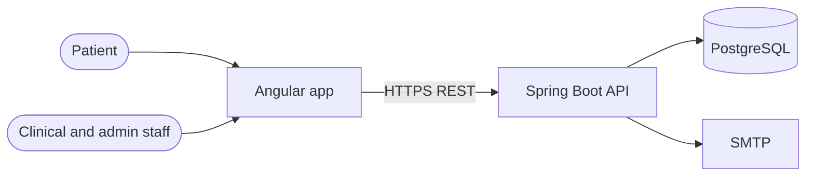

# Architecture: CareConnect

Companion to `PRD.md`. The PRD defines **what and why**; this document defines **how**. Technology versions below must be checked against official documentation at project setup and recorded in `DECISIONS.md`.

## 1. Architecture Summary

| Concern | Choice |
|---|---|
| Style | Modular monolith (one deployable Spring Boot application, strict module boundaries) |
| Backend | Java (current LTS), Spring Boot 3.x, Maven |
| Frontend | Angular (current supported version), TypeScript, Angular Material |
| Primary database | PostgreSQL 16 (transactional clinical data), Flyway migrations |
| Security | Spring Security, JWT access token, refresh token in HttpOnly cookie, method-level authorization |
| API | REST over JSON, versioned `/api/v1`, OpenAPI via springdoc |
| Testing | JUnit 5, Mockito, Testcontainers, ArchUnit; Angular unit tests; Playwright end-to-end |
| Runtime | Docker Compose (backend, frontend/Nginx, PostgreSQL, Mailpit) |
| CI | GitHub Actions: build, lint, unit and integration tests |

Why a modular monolith: one developer, one deadline, strong transactional needs (signing an order must be atomic with its safety snapshot). Microservices would add network failure modes and deployment work without benefit. Module boundaries are enforced so a split stays possible later.

## 2. System Context



## 3. Backend Structure

### 3.1 Modules

Each module owns its tables, entities, services and API. Module names match the PRD.

| Module | Responsibility | PRD requirements |
|---|---|---|
| `auth` | Login, tokens, RBAC, staff accounts, portal activation | FR-01 to FR-04 |
| `patient` | Patient registry, allergies, problems, summary | FR-05 to FR-10 |
| `scheduling` | Availability, appointments, check-in, encounters | FR-11 to FR-14 |
| `clinical` | Vitals, notes, addenda, diagnoses, timeline | FR-15 to FR-19 |
| `orders` | Medication orders, safety engine, overrides, lifecycle | FR-20 to FR-23 |
| `pharmacy` | Formulary, interaction rules, verification, dispensing, active list, refills, MAR | FR-26 to FR-31 |
| `lab` | Lab catalogue, lab orders, results | FR-24, FR-25 |
| `portal` | Patient-facing read models and actions | FR-32 to FR-34 |
| `messaging` | Secure messages and notifications | FR-35, FR-36 |
| `audit` | Audit capture and review (PostgreSQL) | FR-37 to FR-39 |
| `reporting` | Operational reports | FR-40 |
| `common` | Error model, base classes, utilities, configuration | all |

### 3.2 Package layout

```
backend/src/main/java/com/careconnect/
├── CareConnectApplication.java
├── common/            error handling, base entity, time, validation, config
├── auth/
│   ├── api/           controllers and DTOs
│   ├── service/       business logic
│   ├── domain/        entities and enums
│   └── repository/    Spring Data repositories
├── patient/           (same four sub-packages)
├── scheduling/
├── clinical/
├── orders/
│   └── safety/        SafetyRule interface and rule implementations
├── pharmacy/
├── lab/
├── portal/
├── messaging/
├── audit/
└── reporting/
```

### 3.3 Layering and dependency rules

```
Controller (api)  →  Service  →  Repository  →  Database
```

- Controllers handle HTTP, validation and DTO mapping only. No business rules.
- Services hold business rules and transactions.
- Repositories are accessed only by the service of the same module.
- A module may call another module's **service interface**, never its repository or entities directly.
- Entities are never returned from the API; DTOs are.
- These rules are enforced by ArchUnit tests that fail the build when broken.

### 3.4 Medication safety engine (core OOAD design)

Strategy pattern. Each rule implements one interface and returns alerts.

```
SafetyRule (interface)
├── AllergyRule             allergy match against patient's active allergies
├── DuplicateTherapyRule    another active order for the same drug
├── InteractionCheckRule    pairwise check against patient's active medications
└── DoseRangeRule           dose and daily total against formulary limits

SafetyCheckService  →  runs all SafetyRule beans  →  List<SafetyAlert>
SafetyAlert: type, level (INFO, WARNING, CRITICAL), overridable (boolean), message
```

- New rules are added by adding a class; no existing code changes.
- Signing re-runs all rules on the server; the client's earlier result is never trusted.
- The alert list is stored as a JSONB snapshot on the order; overrides are stored as `order_override` rows.
- Contraindicated interaction and duplicate therapy are `overridable = false`.

### 3.5 Order and note state handling

State transitions live in the domain object (for example `MedicationOrder.sign()`, `.verify()`, `.discontinue()`), which throws a domain exception on an invalid transition. Controllers never set status fields directly. Allowed transitions are the ones in the PRD state diagrams.

### 3.6 Audit design

- An `@Audited` annotation plus an aspect records create, update, sign, verify, override and similar actions.
- A chart-access interceptor records every patient chart view (BR-12).
- Events go through `AuditService` to the `audit_event` table in PostgreSQL. Business-action events are written **in the same transaction** as the action, so both commit or both roll back; if the audit write fails, the request fails (fail-closed). Denied and failed-login events use a separate transaction (`REQUIRES_NEW`) so they survive the rollback.
- Audit events contain no clinical free text beyond identifiers and before/after values required by FR-07.
- Logs written to files must not contain patient names or note content.

## 4. Security Architecture

| Area | Design |
|---|---|
| Passwords | BCrypt (cost 12) or Argon2; never logged |
| Lockout | 5 failed logins lock the account for 15 minutes |
| Access token | JWT, 15 minutes, held in browser memory only |
| Refresh token | Opaque random value, stored hashed in the database, rotated on every use, sent as HttpOnly, Secure, SameSite=Strict cookie |
| Authorization | Roles checked with method security (`@PreAuthorize`) on service methods, not only controllers |
| Patient isolation | `PatientAccessPolicy`: a PATIENT may access only the patient id inside their token; staff access is checked per role and module |
| Input | Jakarta Bean Validation on every DTO; parameterized queries only (JPA); length and format limits |
| Transport | TLS everywhere outside local development; HSTS; CORS limited to the frontend origin |
| Headers | Content-Security-Policy, X-Content-Type-Options, frame protection configured in Nginx and Spring |
| Secrets | Environment variables; `.env.example` committed, real `.env` never |
| Dependencies | Dependency vulnerability scan in CI |
| Rate limiting | On login and portal activation endpoints |

Details and checklist are in `SECURITY.md`.

## 5. Data Architecture

### 5.1 PostgreSQL

- Schema managed only by Flyway migrations (`V1__...sql`). Hibernate `ddl-auto` is `validate`, never `update`.
- Foreign keys, not-null and check constraints are defined in the database, not only in code.
- Clinical data is never hard-deleted; status columns with a reason are used (BR-08).
- Optimistic locking with a `version` column on patient, note and order.
- Timestamps in UTC (`timestamptz`).
- Free-form structured content (note sections, safety snapshot) uses JSONB.
- Indexes: patient (mrn unique, last_name, phone, dob), appointment (provider_id, slot_start), medication_order (patient_id, status), lab_order (patient_id, status).

### 5.2 Audit table

- Table `audit_event` in PostgreSQL with indexes on `timestamp`, `(patient_id, timestamp)`, `(user_id, timestamp)`; `details` is JSONB.
- The application role has INSERT and SELECT only; a trigger rejects UPDATE and DELETE.
- Access goes through an `AuditStore` interface so the storage can be moved later (for example to a separate database) without touching callers.
- Clinical notes stay in PostgreSQL (JSONB) because signing must be transactional with other clinical data.

### 5.3 Reference and demo data

- Formulary, interaction rules, ICD-10 subset and lab catalogue are loaded by Flyway repeatable migrations or a seed profile.
- Patients, staff and encounters for demos come from a deterministic synthetic seed script. Nothing real is ever used.

## 6. API Design

- Base path `/api/v1`; JSON; ISO-8601 dates; pagination with `page`, `size`, `sort`.
- Errors use RFC 7807 problem details with a stable `code` field (for example `ORDER_CONTRAINDICATED`, `SLOT_TAKEN`).
- Status codes: 400 validation, 401 unauthenticated, 403 unauthorized, 404 not found, 409 business rule or lock conflict.
- Every state change is an explicit action endpoint, not a generic update.

Representative endpoints:

| Area | Endpoint | Roles |
|---|---|---|
| Auth | `POST /auth/login`, `POST /auth/refresh`, `POST /auth/logout` | public / authenticated |
| Patients | `POST /patients`, `GET /patients?query=`, `GET /patients/:id/summary` | RECEPTIONIST, DOCTOR, NURSE |
| Allergies | `POST /patients/:id/allergies`, `PATCH /allergies/:id/status` | DOCTOR, NURSE |
| Scheduling | `GET /providers/:id/slots`, `POST /appointments`, `POST /appointments/:id/cancel`, `POST /appointments/:id/check-in` | RECEPTIONIST, PATIENT (own) |
| Clinical | `POST /encounters/:id/vitals`, `POST /encounters/:id/notes`, `POST /notes/:id/sign`, `POST /notes/:id/addenda` | NURSE, DOCTOR |
| Orders | `POST /encounters/:id/medication-orders`, `POST /medication-orders/:id/sign`, `POST /medication-orders/:id/discontinue` | DOCTOR |
| Pharmacy | `GET /pharmacy/queue`, `POST /medication-orders/:id/verify`, `POST /medication-orders/:id/reject`, `POST /medication-orders/:id/dispense` | PHARMACIST |
| Refills | `POST /medication-orders/:id/refill-requests`, `POST /refill-requests/:id/decision` | PATIENT, DOCTOR |
| Lab | `POST /encounters/:id/lab-orders`, `POST /lab-orders/:id/result`, `POST /lab-results/:id/release` | DOCTOR, LAB_TECHNICIAN |
| Portal | `GET /portal/me/summary`, `GET /portal/me/appointments`, `GET /portal/me/results` | PATIENT |
| Audit | `GET /audit/events?patientId=&userId=&from=&to=` | ADMIN |

## 7. Frontend Architecture

- One Angular application with two lazy-loaded route trees: `/staff/**` and `/portal/**`, each with its own layout shell. (Decision recorded as ADR-005.)
- Standalone components, feature folders, lazy loading by feature.
- State: Angular signals inside feature services; no global store library unless a clear need appears (ADR-012).
- Route guards check role; the server remains the real authority.
- An HTTP interceptor attaches the access token and performs the refresh-and-retry flow; on failure it routes to login.
- Reactive forms with shared validators; one shared error-display component.
- Clinical alert component: severity shown by icon, text and color together (never color alone).

```
frontend/src/app/
├── core/          auth service, interceptors, guards, api client
├── shared/        ui components, pipes, validators
├── layout/        staff shell, portal shell
├── features/
│   ├── auth/
│   ├── patients/
│   ├── scheduling/
│   ├── clinical/
│   ├── orders/
│   ├── pharmacy/
│   ├── lab/
│   ├── portal/
│   ├── messaging/
│   ├── admin/      users, audit, reports
└── app.routes.ts
```

## 8. Key Runtime Flows

1. **Login:** credentials → verify and check lockout → access token in response body, refresh token in cookie → audit LOGIN.
2. **Open chart:** search → select patient → `PatientAccessPolicy` check → summary assembled from patient, clinical, orders and pharmacy services → audit VIEW.
3. **Sign order:** draft → safety engine → alerts → overrides → re-check at sign time → status SIGNED with snapshot → audit SIGN and OVERRIDE → pharmacy queue.
4. **Verify and dispense:** pharmacist opens queue item with allergies and active medications → verify → status VERIFIED → active medication list updates → dispense recorded.
5. **Portal read:** patient id from token → portal read model → only released and shared content.

## 9. Environments and Configuration

| Environment | Purpose | Notes |
|---|---|---|
| local | Development | Docker Compose; Mailpit; seed data profile |
| ci | Automated tests | Testcontainers for PostgreSQL |
| demo | Mentor demonstration | Docker Compose on a single host, TLS in front if exposed |

Configuration comes from environment variables and Spring profiles (`local`, `test`, `demo`). Secrets are never committed; see `.env.example`.

## 10. Testing Architecture

| Layer | Tooling | Scope |
|---|---|---|
| Unit | JUnit 5, Mockito | Services, state transitions, each safety rule |
| Integration | Spring Boot Test, Testcontainers | Repositories, migrations, controllers with security |
| Architecture | ArchUnit | Layering and module boundaries |
| Frontend unit | Angular test runner | Services, guards, key components |
| End-to-end | Playwright | Core journeys through the browser |
| Security | Authorization matrix tests, dependency scan | Role × endpoint |

Details in `TEST_PLAN.md`.

## 11. Observability

- Spring Boot Actuator health and info endpoints (health restricted in demo).
- Structured JSON logs with a correlation id per request; no patient identifiers or note content in logs.
- Basic metrics via Actuator and Micrometer for request time and error counts.

## 12. Deployment View

| Container | Image | Exposes |
|---|---|---|
| frontend | Nginx serving the Angular production build, proxies `/api` | 80/443 |
| backend | Spring Boot jar on a slim Java runtime image | internal 8080 |
| postgres | PostgreSQL 16 with a named volume | internal |
| mailpit | Development SMTP catcher | internal / dev UI |

Backup: documented `pg_dump` command, with one tested restore (NFR-12).

## 13. Architectural Rules (summary)

1. No business logic in controllers or components.
2. No repository access across modules; use service interfaces.
3. All schema changes through Flyway; Hibernate never alters the schema.
4. Authorization is enforced on the server for every operation; the UI only hides things.
5. Every state change goes through a domain method that validates the transition.
6. Every PHI read and write is audited.
7. Only synthetic data in any environment.
8. Clinical rules come from `PRD.md` and `DECISIONS.md`, never invented by the AI assistant while coding.

## 14. Requirement-to-Module Traceability

Every FR in `PRD.md` is covered by exactly one owning module in section 3.1. A new requirement must name its owning module before implementation starts.
