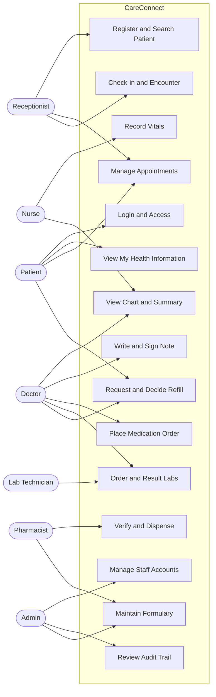
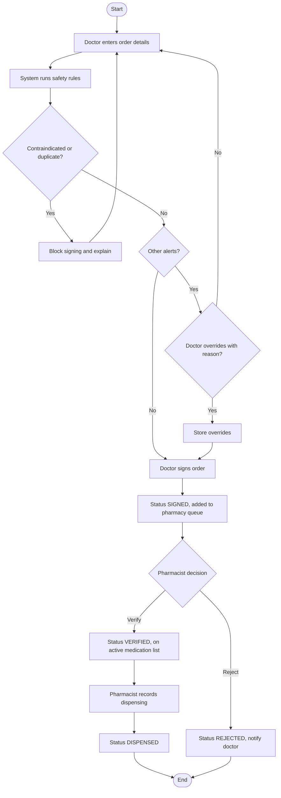
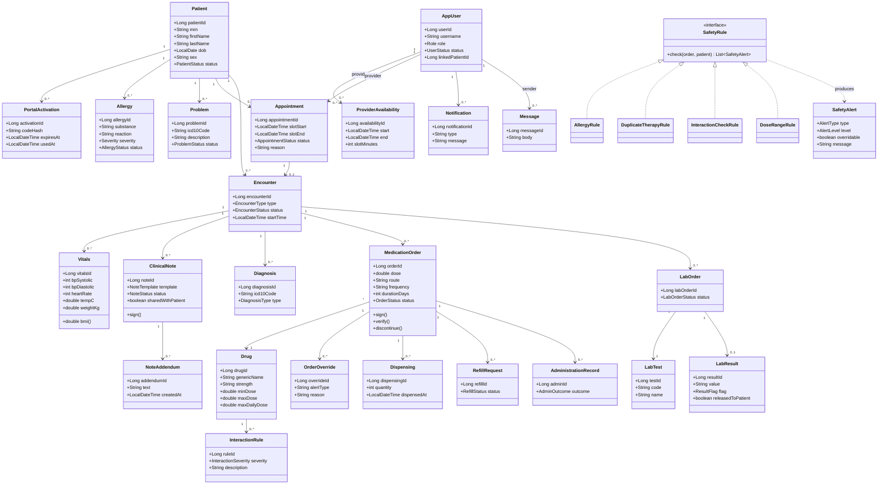
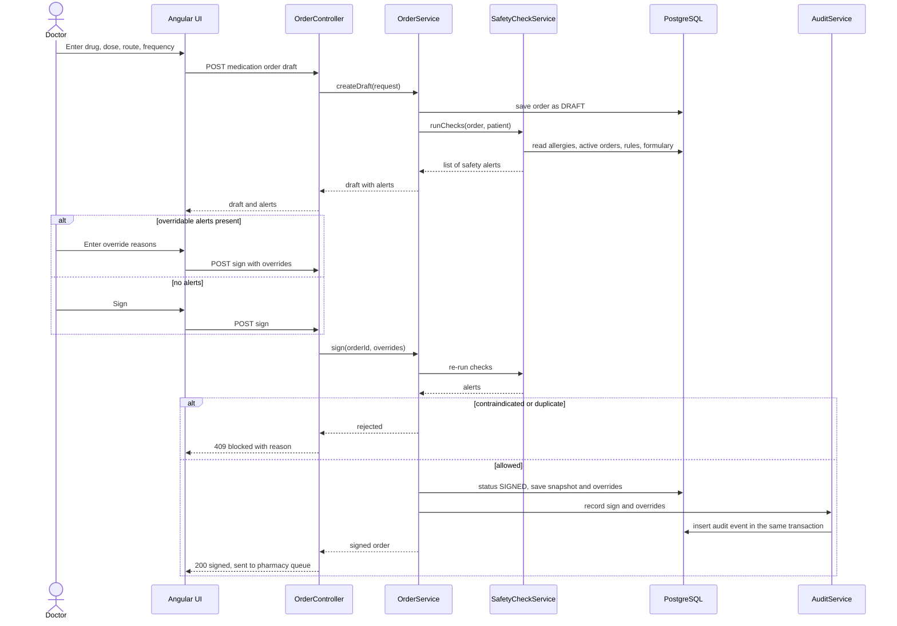
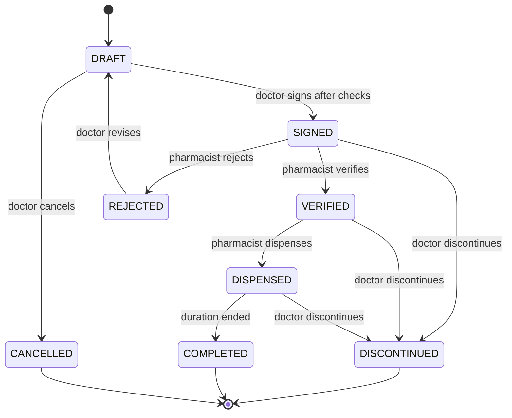
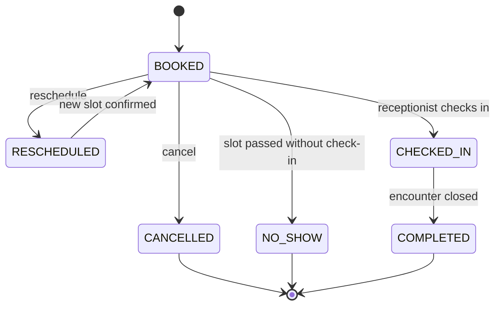
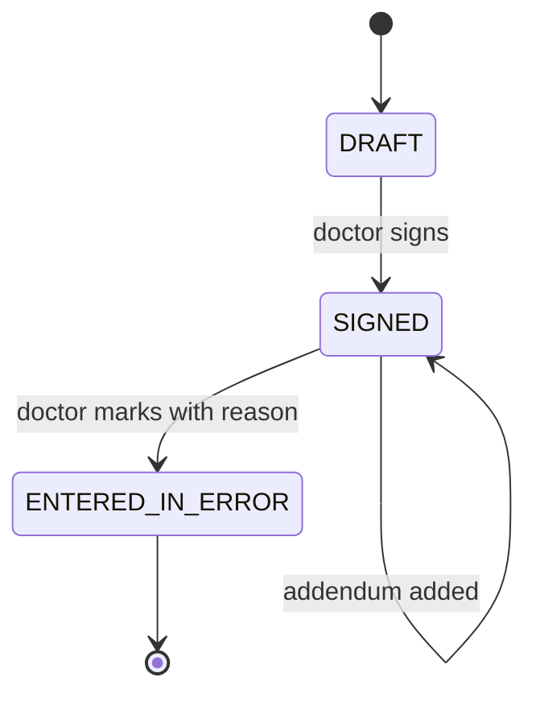
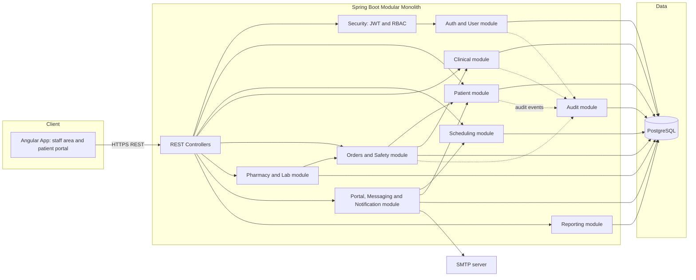
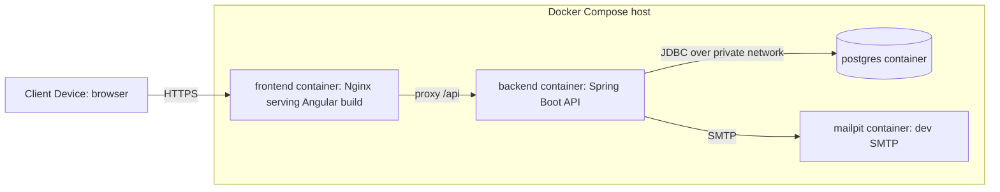
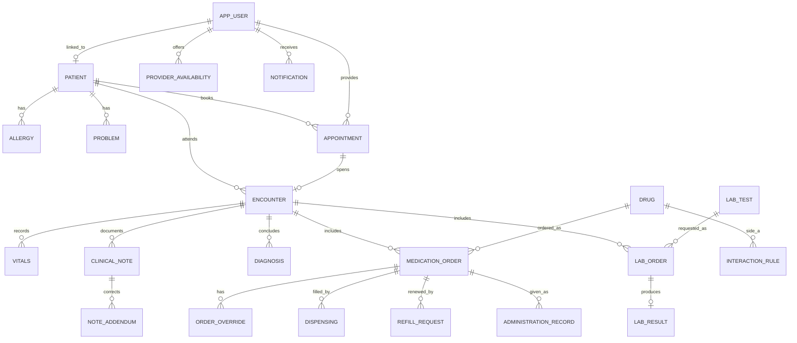

# CareConnect: Patient–Provider EHR
## Product Requirements and OOAD Design Specification

| Document Information | Details |
|---|---|
| Document type | PRD, SRS and OOAD Design Specification |
| Version | 0.1 (Draft for mentor review) |
| Prepared for | Internship project, training and academic demonstration |
| Prepared by | Anurag |
| Date | 19 October 2026 |
| Domain | Healthcare and Pharma |
| Stack | Java, Spring Boot, Angular, PostgreSQL |

> **Safety notice.** CareConnect is a training and demonstration system. It uses synthetic data only. Its drug-interaction and dose-range data is a small demo dataset and is not clinically validated. It must not be used for real patient care.

## Table of Contents

1. Project Overview
2. Software Requirements Specification (SRS)
3. Use Case Model
4. Analysis and Design Diagrams
5. Data Model
6. Traceability and Testing
7. Assumptions, Future Enhancements and Open Items

---

# 1. Project Overview

## 1.1 Project Background

CareConnect is a web-based Electronic Health Record (EHR) system that connects patients and healthcare providers on one platform. Providers keep patient records, document clinical encounters, place medication and lab orders through Computerized Provider Order Entry (CPOE), and manage medications with pharmacist verification. Patients use a portal to view their own health information, manage appointments and request medication refills.

## 1.2 Business Problem

In a typical small clinic or hospital outpatient department, patient information is spread across paper files, spreadsheets and disconnected tools. This causes:

- Providers cannot see a complete, current picture of a patient (allergies, active medications, history) at the moment of care.
- Handwritten or unchecked medication orders create avoidable risk: allergy conflicts, duplicate therapy and harmful interactions go unnoticed.
- Pharmacists cannot reliably verify what was ordered and why.
- Patients have no direct way to see their own records or manage appointments.
- There is no trustworthy record of who viewed or changed sensitive information.

CareConnect centralizes these activities, enforces safety checks at the point of ordering, and records an audit trail of every access and change.

## 1.3 Objectives

| ID | Objective |
|---|---|
| O-1 | Maintain a single, accurate patient record that authorized staff can search and view quickly. |
| O-2 | Support the outpatient workflow: appointment, check-in, vitals, documentation, orders, verification, dispensing. |
| O-3 | Reduce medication risk through automatic allergy, duplicate-therapy, interaction and dose-range checks during ordering. |
| O-4 | Make clinical documentation reliable: signed notes are immutable and corrected only by addendum. |
| O-5 | Give patients secure, read-mostly access to their own information and appointment management. |
| O-6 | Enforce role-based access and record a complete audit trail of access and changes. |

## 1.4 Scope

| In Scope | Out of Scope |
|---|---|
| Patient registration, search, demographics, allergies, problem list | Billing, insurance claims and payments |
| Provider availability, appointment booking, check-in, encounters | Inpatient bed management and admission/discharge/transfer |
| Vitals, clinical notes (SOAP and other templates), diagnoses | Imaging (PACS/radiology) and DICOM |
| CPOE for medications and basic lab orders | Real laboratory or pharmacy external system integration |
| Medication safety checks (demo dataset) | Clinically validated drug database licensing |
| Pharmacist verification, dispensing record, active medication list | Controlled-substance and e-prescribing regulatory workflows |
| Refill requests and decisions | Telemedicine video consultations |
| Patient portal (view summary, appointments, released results, notes) | Native mobile applications |
| Role-based access control and audit trail | Government health-ID integration (for example ABDM) |
| Basic operational reports | AI features (summarization, decision support) |

## 1.5 Stakeholders

| Stakeholder | Interest / Responsibility |
|---|---|
| Patient | Views own health information, manages appointments, requests refills. |
| Doctor (Provider) | Documents encounters, diagnoses, orders medications and labs, signs notes and orders. |
| Nurse | Records vitals, supports encounters, records medication administration. |
| Pharmacist | Verifies medication orders, records dispensing, maintains formulary and interaction rules. |
| Receptionist | Registers patients, manages appointments and check-in. |
| Lab Technician | Enters laboratory results. |
| Administrator | Manages staff accounts and reviews audit trails. |
| Compliance reviewer (mentor/evaluator) | Reviews audit evidence, safety behaviour and documentation. |

## 1.6 Success Criteria

The first version is successful when, using synthetic data only:

1. A receptionist registers a patient and books an appointment; the patient is checked in and an encounter opens.
2. A nurse records vitals; a doctor writes and signs a SOAP note, which can then only be changed by addendum.
3. A doctor places a medication order; the system warns about a known allergy or interaction, requires an override reason where permitted, and blocks contraindicated combinations.
4. A pharmacist verifies the order and records dispensing; the medication appears on the patient's active medication list.
5. A patient logs in to the portal and sees only their own data, books an appointment and requests a refill that the doctor decides.
6. An administrator can search the audit trail and see who viewed, changed, signed or overrode what, and when.
7. Role restrictions hold: a user cannot see or do anything outside their role, and a patient cannot reach another patient's data.

## 1.7 Glossary

| Term | Meaning |
|---|---|
| EHR | Electronic Health Record. |
| CPOE | Computerized Provider Order Entry: doctors enter orders electronically. |
| MRN | Medical Record Number, the unique patient identifier inside the system. |
| Encounter | One clinical interaction (visit) between a patient and a provider. |
| SOAP | Subjective, Objective, Assessment, Plan: a common clinical note structure. |
| Formulary | The list of drugs the organization allows to be ordered. |
| MAR | Medication Administration Record. |
| PHI | Protected Health Information. In this project all data is synthetic. |
| Addendum | A dated correction or addition attached to a signed note without changing the original. |
| Break-glass | Emergency access to a record outside normal permissions, with a reason and extra audit. |

---

# 2. Software Requirements Specification (SRS)

## 2.1 Purpose

This SRS defines the functional behaviour, quality expectations, interfaces, data requirements, constraints and acceptance conditions for CareConnect version 1.

## 2.2 Product Perspective

CareConnect is a multi-user web application: an Angular browser client, a Spring Boot REST service, and a single PostgreSQL relational database that holds transactional clinical data and the append-only audit trail. Email notifications go through an SMTP interface (a local mail catcher in development).

## 2.3 User Classes

| Role | Main Capabilities |
|---|---|
| PATIENT | View own summary, appointments, released results and shared notes; book or cancel own appointments; request refills; message provider. |
| DOCTOR | Search patients and view charts; document encounters; sign notes; order medications and labs; decide refills; override permitted safety warnings with reason. |
| NURSE | View charts; record vitals; record medication administration. |
| PHARMACIST | Verify or reject medication orders; record dispensing; maintain formulary and interaction rules. |
| RECEPTIONIST | Register patients; manage provider availability and appointments; check patients in; issue portal activation codes. |
| LAB_TECHNICIAN | View lab orders; enter lab results. |
| ADMIN | Manage staff accounts; review audit trail; view reports; manage reference data. |

## 2.4 Functional Requirements

Priority uses MoSCoW: **M** = must have, **S** = should have, **C** = could have. The MVP is all M items; S items follow; C items only if time allows.

### Access and Identity

| ID | Requirement | Description | Priority |
|---|---|---|---|
| FR-01 | Authentication | The system shall authenticate users with credentials, issue short-lived access tokens with refresh, and support logout. | M |
| FR-02 | Role-Based Access | The system shall enforce role-based authorization on the server for every protected operation. | M |
| FR-03 | Staff Account Management | The administrator shall create, update, deactivate and reset staff accounts. | M |
| FR-04 | Portal Activation | A patient shall activate a portal account using a one-time code issued by staff and linked to the patient record. | S |

### Patient Records

| ID | Requirement | Description | Priority |
|---|---|---|---|
| FR-05 | Register Patient | Authorized staff shall register a patient with demographics; the system shall generate a unique MRN. | M |
| FR-06 | Search Patients | Authorized staff shall search patients by name, MRN, phone or date of birth. | M |
| FR-07 | Update Demographics | Authorized staff shall update demographics; each change shall record before and after values in the audit trail. | M |
| FR-08 | Manage Allergies | Authorized clinical staff shall add allergies (substance, reaction, severity) and mark them inactive or entered-in-error. | M |
| FR-09 | Manage Problem List | Clinicians shall record and resolve problems and medical history using ICD-10 coded entries. | M |
| FR-10 | Patient Summary | The system shall show a chart summary: demographics, allergies, active problems, active medications and latest vitals. | M |

### Scheduling and Encounters

| ID | Requirement | Description | Priority |
|---|---|---|---|
| FR-11 | Provider Availability | Staff shall define provider availability as time slots. | S |
| FR-12 | Book Appointment | Staff or the patient shall book an available slot with a provider. | M |
| FR-13 | Reschedule or Cancel | Staff or the patient shall reschedule or cancel an appointment. | M |
| FR-14 | Check-In and Encounter | The receptionist shall check in a patient, which opens an encounter. | M |

### Clinical Documentation

| ID | Requirement | Description | Priority |
|---|---|---|---|
| FR-15 | Record Vitals | Nurses or doctors shall record vitals for an encounter; the system shall compute BMI. | M |
| FR-16 | Draft Clinical Note | A doctor shall create a note from a template (SOAP, progress, discharge summary) and save it as a draft. | M |
| FR-17 | Sign Note and Addendum | A doctor shall sign a note, after which it is immutable; later corrections are dated addenda. | M |
| FR-18 | Encounter Diagnoses | A doctor shall record primary and secondary diagnoses on an encounter. | M |
| FR-19 | Encounter Timeline | Clinicians shall view a chronological timeline of a patient's encounters and related items. | S |

### Orders (CPOE)

| ID | Requirement | Description | Priority |
|---|---|---|---|
| FR-20 | Place Medication Order | A doctor shall create a medication order (drug, dose, route, frequency, duration, instructions). | M |
| FR-21 | Medication Safety Checks | Before signing, the system shall check allergy conflicts, duplicate therapy, drug–drug interactions and dose ranges, and show alerts. | M |
| FR-22 | Override with Reason | The doctor may override permitted alerts with a mandatory reason; contraindicated combinations shall be blocked. | M |
| FR-23 | Order Lifecycle | Medication orders shall move through draft, signed, verified, dispensed and end states (discontinued, completed, cancelled, rejected) under defined rules. | M |
| FR-24 | Place Lab Order | A doctor shall order a lab test from the lab test catalogue. | M |
| FR-25 | Lab Results | A lab technician shall enter results with abnormal flags; a provider shall review and release them to the patient. | M |

### Medication Management

| ID | Requirement | Description | Priority |
|---|---|---|---|
| FR-26 | Formulary and Rules | Authorized staff shall maintain formulary drugs and interaction rules. | M |
| FR-27 | Pharmacist Verification | A pharmacist shall review signed medication orders and verify or reject them with a reason. | M |
| FR-28 | Dispensing Record | A pharmacist shall record dispensing of a verified order. | S |
| FR-29 | Active Medication List | The system shall derive a patient's active medication list from verified and dispensed orders. | M |
| FR-30 | Medication Administration | A nurse shall record whether a scheduled dose was given, held or refused. | M |
| FR-31 | Refill Requests | A patient shall request a refill; the doctor shall approve or deny it. | S |

### Patient Portal and Communication

| ID | Requirement | Description | Priority |
|---|---|---|---|
| FR-32 | Patient Health Summary | A patient shall view their own summary: allergies, problems, active medications and visits. | M |
| FR-33 | Patient Appointments | A patient shall view, book and cancel their own appointments. | M |
| FR-34 | Released Results and Notes | A patient shall view lab results released to them and notes marked as shared. | S |
| FR-35 | Secure Messaging | A patient and their provider shall exchange messages inside the system. | C |
| FR-36 | Notifications | The system shall generate in-app and email notifications for appointment reminders, refill decisions and released results. | S |

### Audit, Governance and Reporting

| ID | Requirement | Description | Priority |
|---|---|---|---|
| FR-37 | Audit Trail Capture | The system shall record create, update, view, sign, verify, override and login events with user, role, time, patient and outcome. | M |
| FR-38 | Audit Review | The administrator shall search and filter the audit trail. | M |
| FR-39 | Break-Glass Access | A clinician may access a patient outside normal permissions by giving a reason; such access is flagged. | C |
| FR-40 | Operational Reports | Authorized users shall view appointment, order and safety-override reports. | S |

## 2.5 Non-Functional Requirements

| ID | Category | Requirement |
|---|---|---|
| NFR-01 | Performance | Patient search shall return within 2 seconds and the patient summary within 3 seconds under expected demo load. |
| NFR-02 | Security | Passwords shall be hashed with a strong adaptive algorithm; access tokens shall be short-lived; all traffic shall use TLS outside local development; input shall be validated on the server. |
| NFR-03 | Privacy | Only synthetic data shall be used. Least-privilege access shall apply: users see only data their role needs. |
| NFR-04 | Availability | The service shall expose health checks; planned maintenance may interrupt service. |
| NFR-05 | Usability | The interface shall use clear labels, validation and error messages, and target WCAG 2.1 AA for the portal and staff screens. |
| NFR-06 | Reliability | Signing an order or note shall be atomic; concurrent edits shall be detected with optimistic locking. |
| NFR-07 | Maintainability | Business rules shall be separated from controllers and persistence; modules shall interact through service interfaces; the API shall be documented with OpenAPI. |
| NFR-08 | Auditability | Every read and change of patient data shall be audited; the audit store shall be append-only for application users. |
| NFR-09 | Portability | The system shall run with Docker Compose; persistence shall use JPA and versioned migrations so the relational database can be swapped with limited change. |
| NFR-10 | Data Integrity | Clinical data shall never be hard-deleted; corrections use status values with a reason. Referential integrity shall be enforced in the database. |
| NFR-11 | Interoperability Readiness | Entity naming and structure shall stay compatible with HL7 FHIR concepts (Patient, Encounter, AllergyIntolerance, MedicationRequest) so a FHIR API can be added later. |
| NFR-12 | Recoverability | Backup and restore steps for the database shall be documented and tested once. |

## 2.6 External Interface Requirements

- **User interface:** responsive Angular application with a staff area and a patient portal area, including login, patient chart, scheduling, documentation, orders, pharmacy queue, portal and administration screens.
- **Software interfaces:** PostgreSQL (transactional data and audit trail), SMTP server (email notifications; a mail catcher in development).
- **Communication interfaces:** HTTPS with JSON between browser and API; TLS or private network between API and databases.
- **Hardware interfaces:** none.

## 2.7 Business Rules

| ID | Rule |
|---|---|
| BR-01 | Only a DOCTOR can create, sign or discontinue medication orders and sign clinical notes. |
| BR-02 | A signed note is immutable. Corrections are made with a dated addendum; the original stays visible. |
| BR-03 | A medication order must pass the safety checks before it can be signed; all alerts and their handling are stored with the order. |
| BR-04 | A contraindicated interaction blocks signing and cannot be overridden. A major interaction or an allergy match can be overridden only with a written reason of at least 10 characters; every override is audited. |
| BR-05 | A second active order for the same drug and patient is blocked until the earlier one is discontinued. |
| BR-06 | A signed medication order must be verified by a pharmacist before dispensing. |
| BR-07 | A PATIENT can access only their own data; the patient identity comes from the authenticated token, never from request input. |
| BR-08 | Clinical data is never hard-deleted; mistakes are marked entered-in-error with a reason. |
| BR-09 | A provider slot cannot be double-booked. Cancelling inside the configured notice window is flagged. |
| BR-10 | An encounter opens only from check-in of a booked appointment or a walk-in registered by a receptionist or doctor. |
| BR-11 | A lab result is visible to the patient only after a provider reviews and releases it. |
| BR-12 | Every access to a patient chart creates an audit entry. |
| BR-13 | Break-glass access requires a reason and is flagged for admin review. |
| BR-14 | An MRN is unique and never changes. |
| BR-15 | A refill can be requested only for an active medication that has refills remaining. |
| BR-16 | An allergy entry is never deleted; it becomes inactive or entered-in-error. |
| BR-17 | Dose-range checks compare the ordered dose and daily total with the formulary minimum and maximum. |

## 2.8 Assumptions and Constraints

- All data is synthetic; no real patient data is entered at any time.
- The formulary and interaction rules are a small demo dataset created for this project.
- Clinical rule values (BR-04, BR-05, BR-17) are configurable and reviewed by the project owner before use.
- One organization (single tenant) is assumed.
- Email delivery is simulated in development.
- Time zone is Asia/Kolkata for display; timestamps are stored in UTC.

---

# 3. Use Case Model

## 3.1 Use Case Diagram

## 3.2 Use Case Catalogue

| ID | Use Case | Primary Actor | Goal | Requirements |
|---|---|---|---|---|
| UC-01 | Login | All users | Authenticate and open the role-appropriate home screen. | FR-01, FR-02 |
| UC-02 | Manage Staff Accounts | Admin | Create, update, deactivate or reset staff accounts. | FR-03 |
| UC-03 | Activate Portal Account | Patient | Link a portal login to the patient record using a one-time code. | FR-04 |
| UC-04 | Register Patient | Receptionist | Create a patient record with a generated MRN. | FR-05 |
| UC-05 | Search and Open Chart | Doctor, Nurse, Receptionist | Find a patient and view the chart summary. | FR-06, FR-10, FR-37 |
| UC-06 | Update Demographics | Receptionist | Correct patient details with audit. | FR-07 |
| UC-07 | Manage Allergies | Doctor, Nurse | Record and maintain allergy information. | FR-08 |
| UC-08 | Manage Problem List | Doctor | Record and resolve problems and history. | FR-09 |
| UC-09 | Manage Provider Availability | Receptionist | Define bookable slots for a provider. | FR-11 |
| UC-10 | Book Appointment | Receptionist, Patient | Reserve a slot with a provider. | FR-12 |
| UC-11 | Reschedule or Cancel Appointment | Receptionist, Patient | Change or cancel a booking. | FR-13 |
| UC-12 | Check In and Open Encounter | Receptionist | Mark the patient as arrived and open an encounter. | FR-14 |
| UC-13 | Record Vitals | Nurse, Doctor | Capture vitals for the encounter. | FR-15 |
| UC-14 | Write and Sign Note | Doctor | Document the encounter, add diagnoses and sign. | FR-16, FR-17, FR-18 |
| UC-15 | Add Addendum | Doctor | Correct or extend a signed note. | FR-17 |
| UC-16 | View Encounter Timeline | Doctor, Nurse | See the patient's encounters in order. | FR-19 |
| UC-17 | Place Medication Order | Doctor | Order a medication with safety checks and sign it. | FR-20, FR-21, FR-22, FR-23 |
| UC-18 | Discontinue Medication Order | Doctor | Stop an active order with a reason. | FR-23 |
| UC-19 | Place Lab Order | Doctor | Order a lab test. | FR-24 |
| UC-20 | Enter and Release Lab Result | Lab Technician, Doctor | Record, review and release a result. | FR-25 |
| UC-21 | Maintain Formulary and Rules | Pharmacist, Admin | Manage drugs and interaction rules. | FR-26 |
| UC-22 | Verify Medication Order | Pharmacist | Verify or reject a signed order. | FR-27 |
| UC-23 | Dispense Medication | Pharmacist | Record dispensing of a verified order. | FR-28 |
| UC-24 | View Active Medications | Doctor, Nurse, Pharmacist | See current verified or dispensed medications. | FR-29 |
| UC-25 | Record Medication Administration | Nurse | Record given, held or refused doses. | FR-30 |
| UC-26 | Request and Decide Refill | Patient, Doctor | Request a refill and decide on it. | FR-31 |
| UC-27 | View My Health Summary | Patient | View own allergies, problems, medications and visits. | FR-32 |
| UC-28 | Manage My Appointments | Patient | View, book and cancel own appointments. | FR-33 |
| UC-29 | View Released Results and Notes | Patient | View released lab results and shared notes. | FR-34 |
| UC-30 | Secure Messaging | Patient, Doctor | Exchange messages. | FR-35 |
| UC-31 | Receive Notifications | All users | See reminders and updates. | FR-36 |
| UC-32 | Review Audit Trail | Admin | Search who accessed or changed what. | FR-37, FR-38 |
| UC-33 | Break-Glass Access | Doctor | Access a chart outside normal permissions with a reason. | FR-39 |
| UC-34 | Generate Reports | Admin, Doctor | View operational and safety reports. | FR-40 |

## 3.3 Detailed Use Case: UC-17 Place Medication Order

| Field | Details |
|---|---|
| Primary actor | Doctor |
| Trigger | Doctor decides to prescribe a medication during an open encounter. |
| Preconditions | Doctor is logged in; patient chart is open; an encounter is open; the drug exists in the formulary. |
| Postconditions | A signed medication order exists with its safety-check snapshot and any overrides; a pharmacist verification task is created; an audit entry is written. |
| Main flow | 1. Doctor selects the drug and enters dose, route, frequency, duration and instructions. 2. System runs the safety rules: allergy, duplicate therapy, interaction, dose range. 3. System shows no alerts. 4. Doctor signs the order. 5. System stores the order as SIGNED with the safety snapshot. 6. System adds the order to the pharmacist verification queue. 7. System writes the audit entry. |
| Alternate A1 | Alerts present and overridable: system lists alerts; doctor revises the order (return to step 1) or enters an override reason for each alert; system stores overrides and continues at step 4. |
| Alternate A2 | Contraindicated interaction: system blocks signing and explains why; doctor must change the order or cancel. |
| Alternate A3 | Duplicate active order: system blocks signing until the earlier order is discontinued. |
| Exceptions | Drug inactive in the formulary: order rejected. Concurrent change to the chart (allergy added meanwhile): signing re-runs the checks and shows new alerts. Audit store unavailable: signing fails and the doctor is told to retry. |

## 3.4 Detailed Use Case: UC-14 Write and Sign Note

| Field | Details |
|---|---|
| Primary actor | Doctor |
| Trigger | Doctor documents an encounter. |
| Preconditions | Doctor is logged in; encounter is open. |
| Postconditions | A signed, immutable note and its diagnoses exist; an audit entry is written. |
| Main flow | 1. Doctor selects a template and writes the note; system saves a draft. 2. Doctor adds one primary diagnosis and optional secondary diagnoses. 3. Doctor reviews and signs. 4. System sets status SIGNED, records time and author, and locks the content. 5. System writes the audit entry. |
| Alternate A1 | Doctor wants to share the note with the patient: marks it shared; it appears in the portal after signing. |
| Alternate A2 | Correction needed after signing: doctor adds an addendum (UC-15); the original is unchanged. |
| Exceptions | Another user edited the draft meanwhile: optimistic lock error; doctor reloads. Signing without a primary diagnosis: validation error. |

## 3.5 Detailed Use Case: UC-22 Verify Medication Order

| Field | Details |
|---|---|
| Primary actor | Pharmacist |
| Trigger | A signed medication order appears in the verification queue. |
| Preconditions | Pharmacist is logged in; order status is SIGNED. |
| Postconditions | Order is VERIFIED or REJECTED; audit entry is written; the doctor is notified of a rejection. |
| Main flow | 1. Pharmacist opens the order with the patient's allergies, active medications and the stored safety snapshot. 2. Pharmacist verifies the order. 3. System sets status VERIFIED and adds it to the active medication list. |
| Alternate A1 | Pharmacist finds a problem: rejects with a reason; status becomes REJECTED and the doctor is notified. |
| Exceptions | Order was discontinued meanwhile: system shows its current status and blocks verification. |

---

# 4. Analysis and Design Diagrams

## 4.1 Activity Diagram: Medication Order Lifecycle

## 4.2 Class Diagram

## 4.3 Sequence Diagram: Place and Sign a Medication Order

## 4.4 State Machine Diagrams

### Medication Order

### Appointment

### Clinical Note

## 4.5 Component Diagram

## 4.6 Deployment Diagram

---

# 5. Data Model

## 5.1 Main Entities (PostgreSQL)

| Entity (table) | Important Attributes |
|---|---|
| AppUser (app_user) | user_id, username, password_hash, role, status, linked_patient_id, failed_attempts, locked_until, last_login_at |
| PortalActivation (portal_activation) | activation_id, patient_id, code_hash, expires_at, used_at |
| Patient (patient) | patient_id, mrn, first_name, last_name, dob, sex, phone, email, address, emergency_contact, status, version |
| Allergy (allergy) | allergy_id, patient_id, substance, drug_id (optional), reaction, severity, status, recorded_by, recorded_at |
| Problem (problem) | problem_id, patient_id, icd10_code, description, onset_date, status, recorded_by |
| ProviderAvailability (provider_availability) | availability_id, provider_id, start_time, end_time, slot_minutes |
| Appointment (appointment) | appointment_id, patient_id, provider_id, slot_start, slot_end, reason, status, booked_by, cancelled_reason |
| Encounter (encounter) | encounter_id, patient_id, provider_id, appointment_id (optional), type, status, start_time, end_time |
| Vitals (vitals) | vitals_id, encounter_id, recorded_by, bp_systolic, bp_diastolic, heart_rate, temp_c, spo2, height_cm, weight_kg, recorded_at |
| ClinicalNote (clinical_note) | note_id, encounter_id, author_id, template, content (JSONB), status, shared_with_patient, signed_at, version |
| NoteAddendum (note_addendum) | addendum_id, note_id, author_id, text, created_at |
| Diagnosis (diagnosis) | diagnosis_id, encounter_id, icd10_code, description, type |
| Drug (drug) | drug_id, generic_name, brand_name, form, strength, route, min_dose, max_dose, max_daily_dose, unit, active |
| InteractionRule (interaction_rule) | rule_id, drug_a_id, drug_b_id, severity, description |
| MedicationOrder (medication_order) | order_id, encounter_id, patient_id, drug_id, dose, unit, route, frequency, duration_days, instructions, status, ordered_by, signed_at, verified_by, verified_at, reject_reason, discontinue_reason, refills_allowed, refills_used, safety_snapshot (JSONB), version |
| OrderOverride (order_override) | override_id, order_id, alert_type, alert_level, reason, overridden_by, overridden_at |
| Dispensing (dispensing) | dispensing_id, order_id, pharmacist_id, quantity, dispensed_at |
| RefillRequest (refill_request) | refill_id, order_id, patient_id, status, requested_at, decided_by, decided_at, decision_note |
| AdministrationRecord (administration_record) | admin_id, order_id, nurse_id, scheduled_time, given_time, outcome, reason |
| LabTest (lab_test) | test_id, code, name, unit, ref_low, ref_high |
| LabOrder (lab_order) | lab_order_id, encounter_id, patient_id, test_id, ordered_by, status, ordered_at |
| LabResult (lab_result) | result_id, lab_order_id, value, unit, flag, entered_by, entered_at, reviewed_by, reviewed_at, released_to_patient |
| Notification (notification) | notification_id, user_id, type, message, status, created_at, read_at |
| Message (message) | message_id, thread_id, sender_id, recipient_id, patient_id, body, sent_at, read_at |

## 5.2 Audit Trail (PostgreSQL table `audit_event`)

| Field | Description |
|---|---|
| audit_id | Generated identifier (bigserial) |
| timestamp | Event time (UTC) |
| user_id, username, role | Who acted |
| action | LOGIN, LOGIN_FAILED, VIEW, CREATE, UPDATE, SIGN, VERIFY, REJECT, OVERRIDE, DISCONTINUE, BREAK_GLASS and similar |
| entity_type, entity_id | What was affected |
| patient_id | Patient the event relates to, when any |
| outcome | SUCCESS or DENIED |
| ip_address | Source address |
| details (JSONB) | Flexible object: before and after values, override reason, search filters |

The application database role has INSERT and SELECT rights on this table only; UPDATE and DELETE are revoked and a trigger rejects them even for other roles. Indexes: timestamp, (patient_id, timestamp), (user_id, timestamp). Audit rows for business actions are written in the same transaction as the action, so an action and its audit record succeed or fail together. Denied and failed-login events are written in a separate transaction so they survive the rollback of the request.

## 5.3 Relationship Summary

- One Patient has many Allergies, Problems, Appointments and Encounters.
- One AppUser with role PATIENT links to exactly one Patient; staff users link to none.
- One Appointment leads to zero or one Encounter.
- One Encounter has many Vitals, ClinicalNotes, Diagnoses, MedicationOrders and LabOrders.
- One ClinicalNote has many NoteAddenda.
- One Drug has many InteractionRules (as either side of the pair).
- One MedicationOrder has many OrderOverrides, Dispensings (one per fill), RefillRequests and AdministrationRecords.
- One LabOrder refers to one LabTest and has zero or one LabResult.
- One AppUser receives many Notifications and sends many Messages.

## 5.4 Entity-Relationship Diagram

---

# 6. Traceability and Testing

## 6.1 Requirements Traceability Matrix

| Requirement | Use Case | Design Element | Sample Test Coverage |
|---|---|---|---|
| FR-01 | UC-01 | AuthService, JwtAuthFilter | TC-01 valid login; TC-02 invalid credentials and lockout after 5 failures; TC-03 expired token refresh |
| FR-02 | UC-01 | SecurityConfig, method security | TC-04 wrong role gets 403; TC-05 patient cannot reach another patient's data |
| FR-03 | UC-02 | UserAdminService | TC-06 create staff account; TC-07 deactivated user cannot log in |
| FR-04 | UC-03 | PortalActivationService | TC-08 activation with valid code; TC-09 expired or used code rejected |
| FR-05 | UC-04 | PatientService | TC-10 registration generates unique MRN; TC-11 possible duplicate warned |
| FR-06 | UC-05 | PatientService, PatientRepository | TC-12 search by name and MRN; TC-13 no result shown clearly |
| FR-07 | UC-06 | PatientService, AuditService | TC-14 update stores before and after values |
| FR-08 | UC-07 | AllergyService | TC-15 add allergy; TC-16 delete not allowed, entered-in-error works |
| FR-09 | UC-08 | ProblemService | TC-17 add problem; TC-18 resolve problem |
| FR-10 | UC-05 | PatientSummaryService | TC-19 summary shows allergies, problems, active medications, vitals |
| FR-11 | UC-09 | SchedulingService | TC-20 create availability; TC-21 overlapping availability rejected |
| FR-12 | UC-10 | SchedulingService | TC-22 book free slot; TC-23 double booking rejected |
| FR-13 | UC-11 | SchedulingService | TC-24 reschedule; TC-25 late cancellation flagged |
| FR-14 | UC-12 | EncounterService | TC-26 check-in opens encounter; TC-27 cancelled appointment cannot check in |
| FR-15 | UC-13 | VitalsService | TC-28 vitals saved with BMI; TC-29 out-of-range value rejected |
| FR-16 | UC-14 | NoteService | TC-30 save draft; TC-31 only author edits draft |
| FR-17 | UC-14, UC-15 | NoteService | TC-32 sign locks note; TC-33 edit after signing rejected; TC-34 addendum appended |
| FR-18 | UC-14 | EncounterService, Diagnosis | TC-35 add primary diagnosis; signing requires one |
| FR-19 | UC-16 | EncounterService | TC-36 timeline in chronological order |
| FR-20 | UC-17 | OrderService | TC-37 doctor creates draft order; TC-38 non-doctor denied |
| FR-21 | UC-17 | SafetyCheckService, SafetyRule | TC-39 allergy alert; TC-40 duplicate alert; TC-41 interaction alert; TC-42 dose above maximum alert |
| FR-22 | UC-17 | OrderService, OrderOverride | TC-43 override with reason accepted; TC-44 contraindicated blocked; TC-45 override without reason rejected |
| FR-23 | UC-17, UC-18 | OrderService, order state machine | TC-46 sign sets SIGNED; TC-47 discontinue requires reason; TC-48 invalid transition rejected |
| FR-24 | UC-19 | LabService | TC-49 place lab order |
| FR-25 | UC-20 | LabService | TC-50 result flagged abnormal; TC-51 hidden from patient until released |
| FR-26 | UC-21 | FormularyService | TC-52 add drug and rule; TC-53 unauthorized role denied |
| FR-27 | UC-22 | PharmacyService | TC-54 verify order; TC-55 reject with reason returns to doctor |
| FR-28 | UC-23 | PharmacyService | TC-56 dispense verified order; TC-57 unverified order blocked |
| FR-29 | UC-24 | MedicationListService | TC-58 active list contains only verified and dispensed orders |
| FR-30 | UC-25 | MarService | TC-59 record given dose; TC-60 held dose requires reason |
| FR-31 | UC-26 | RefillService | TC-61 refill requested; TC-62 no refills left rejected; TC-63 doctor approves |
| FR-32 | UC-27 | PortalService | TC-64 patient sees only own summary |
| FR-33 | UC-28 | PortalService, SchedulingService | TC-65 patient books and cancels own appointment |
| FR-34 | UC-29 | PortalService | TC-66 shared note visible; TC-67 unshared note hidden |
| FR-35 | UC-30 | MessagingService | TC-68 send and read message; TC-69 cannot read others' thread |
| FR-36 | UC-31 | NotificationService | TC-70 reminder created; TC-71 mark as read |
| FR-37 | UC-32 and all | AuditService, audit aspect | TC-72 chart view audited; TC-73 override audited; TC-74 failed login audited |
| FR-38 | UC-32 | AuditService | TC-75 filter by patient, user and date; TC-76 non-admin denied |
| FR-39 | UC-33 | BreakGlassService | TC-77 requires reason; TC-78 flagged in review |
| FR-40 | UC-34 | ReportService | TC-79 appointment report; TC-80 override report |

## 6.2 Acceptance Criteria

- Given a free slot, when a receptionist books it for a patient, then the appointment is BOOKED and the slot is no longer offered.
- Given a booked appointment, when the receptionist checks the patient in, then the appointment is CHECKED_IN and an open encounter exists.
- Given a draft note with a primary diagnosis, when the doctor signs it, then it becomes SIGNED and any later edit is rejected while an addendum is accepted.
- Given a patient with an active SEVERE allergy to a drug, when a doctor orders that drug, then an allergy alert appears and signing requires an override reason of at least 10 characters.
- Given an interaction rule of severity CONTRAINDICATED between two drugs, when a doctor orders the second drug for a patient on the first, then signing is blocked and cannot be overridden.
- Given an active order for a drug, when a doctor creates another order for the same drug, then signing is blocked until the first order is discontinued.
- Given a SIGNED order, when a pharmacist verifies it, then it becomes VERIFIED and appears in the patient's active medication list.
- Given an unverified order, when a pharmacist tries to record dispensing, then the action is refused.
- Given a logged-in patient, when they request another patient's data by changing an identifier, then the system returns an access-denied response and records the attempt.
- Given a lab result not yet released, when the patient opens their results, then the result is not shown.
- Given any chart view or data change, when the administrator searches the audit trail for that patient, then the event appears with user, role, time and outcome.
- Given a user without the DOCTOR role, when they try to sign a note or order, then access is denied and the attempt is recorded.

---

# 7. Assumptions, Future Enhancements and Open Items

## 7.1 Key Assumptions

- The organization defines its own appointment slot length, late-cancellation window and lockout settings.
- Demo clinical rules are reviewed by the project owner and mentor before demonstration.
- Data migration from existing records is a separate activity and out of scope.
- The mail server is simulated; real delivery is not part of v1.

## 7.2 Possible Future Enhancements

- FHIR R4 API for Patient, Encounter, AllergyIntolerance and MedicationRequest.
- Billing and insurance workflow.
- Inpatient workflow and a fuller medication administration record.
- Integration with a licensed drug database and real laboratory systems.
- Government health-ID integration.
- Telemedicine, mobile apps and reminders by SMS.
- Clinical decision support and analytics dashboards.

## 7.3 Open Items (to confirm with the mentor)

| # | Open item | Current assumption |
|---|---|---|
| 1 | Final project deadline and demo date | Not fixed; phase plan uses effort sizes, not dates. |
| 2 | Does the mentor require Oracle? | Owner decision: PostgreSQL is used; Oracle only if the mentor mandates it, and persistence stays portable for that case. |
| 3 | Required documentation format | Closed: this document keeps the OOAD structure but is written as a working production specification, no filler. |
| 4 | Whether lab orders and the medication administration record are expected | Closed: both expected, so FR-24, FR-25 and FR-30 are MUST. |
| 5 | Whether any real hosting is expected | Closed: local Docker Compose deployment, built to production standards. |

## 7.4 Document Review Checklist

- Requirements are uniquely identified and testable.
- Actors and use cases match the agreed project scope.
- Class names, data model entities and architecture modules use the same names.
- Class responsibilities are clear and not duplicated.
- Sequence messages represent the use-case flow.
- States and transitions cover normal and exceptional conditions.
- Every functional requirement appears in the traceability matrix with a use case, design element and test.
